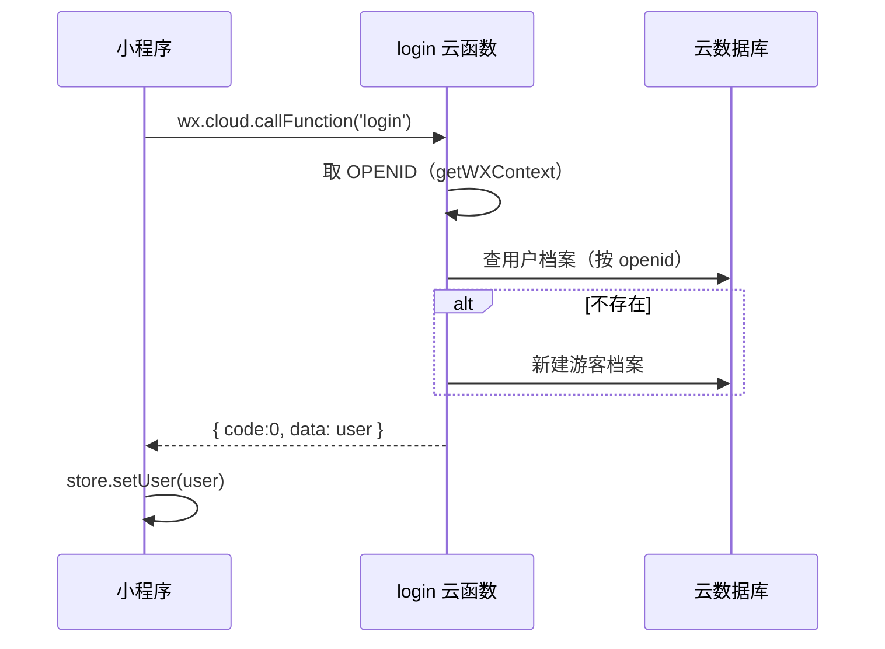
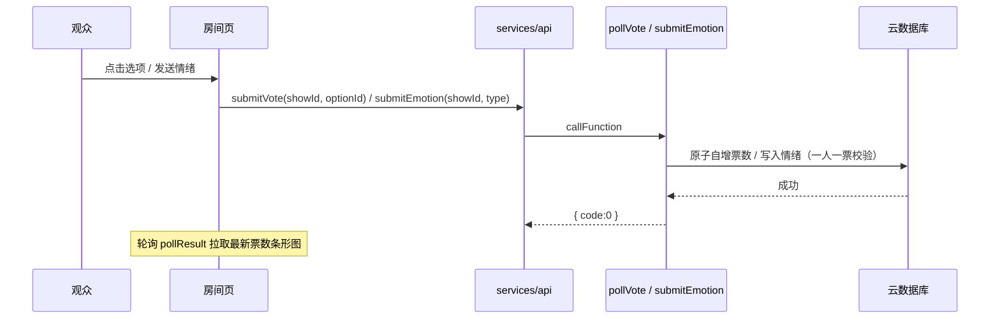
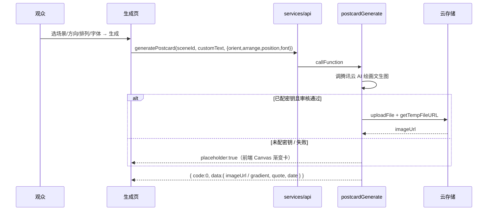
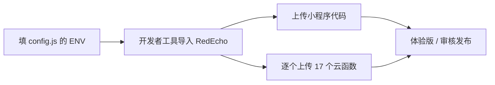

# RedEcho——红色旧址沉浸式互动演出（红韵智演）

> **项目定位**：以宜章县为落地案例（"AIGC+"赋能红色文旅与乡村振兴的实践探索 —— 以宜章县为例），史料内容聚焦宜章县红色旧址与湘南起义。

## 项目简介

RedEcho 是一套基于 **微信小程序原生 + 微信云开发** 的红色旧址沉浸式互动演出平台。它把"看演出"升级为"参与演出"：观众在演出房间内实时投票决定剧情分支、发送情绪反馈上大屏；演出结束后可生成 AIGC 红色主题明信片留念；个人中心沉淀积分，并可在积分商城用积分兑换红色文创好物。

核心能力：

- **首页推荐**：资料卡片（湖南主题红色史料，含宜章县·湘南起义专题 30 条）、直播演出入口、积分概览。
- **资料中心**：按分类（历史事件 / 湘籍伟人 / 红色旧址 / 湖湘精神 / 英烈丰碑）浏览全部资料，详情页看全文。
- **演出实时互动**：投票（原子自增 + 一人一票）、情绪反馈、剧情分支、通知。
- **明信片 AIGC 创作**：场景模板 + 自定义金句（敏感词过滤）+ 排版定制（图片横版/竖版匹配图片朝向、名言横排/竖排、名言位置九宫格、字体仅以修饰词呈现：大气磅礴 / 铁画银钩 / 雄浑端庄 / 清健瘦劲，可注入内置字体文件）+ 文生图（腾讯云 AI 绘画）/ 兜底 CSS 渐变卡（真实明信片比例 3:2 / 2:3，实时预览）；生成后存入「我的作品」，列表页两列网格、预览仅 保存 / 分享 / 打印（点空白关闭）、长按删除。
- **个人中心**：档案、积分、积分商城（文创兑换）、我的阅读（本地阅读历史，每篇标注阅读时间「20XX 年 X 月 XX 日  XX : XX」24 小时制、灰色显示、列表页支持右滑单条删除）、阅读收藏（详情页标题右侧五角星收藏、列表页支持右滑删除与清空，从"我的服务"进入）、演员 AI 台词助手（腾讯云混元）。

## 目录结构概览

```
RedEcho/
├── app.js / app.json / app.wxss      # 全局逻辑、分包+tabBar 配置、设计系统样式
├── config.js                         # 云环境 ID（ENV）+ 调试开关
├── project.config.json               # 开发者工具项目配置（appid / cloudfunctionRoot）
├── project.private.config.json       # 开发者工具本地私有配置（自动生成，建议 gitignore）
├── sitemap.json                      # 索引规则
├── package.json                      # npm 脚本（deploy 命令行上传）
├── store.js                          # 轻量全局状态（用户 / 积分 / 身份）
├── services/                         # 双模服务层（api.js + mock.js + resources.js）
│   └── resources.js                  # 首页资料卡片精选内容（湖南主题红色史料，含宜章县·湘南起义专题 30 条，本地静态源）
├── pages/                            # 主包：4 个 tab 页（home/show/create/mine）
│   ├── resource/                     # 资料中心（list 列表页 + detail 详情页）
│   └── works/                        # 我的作品列表页（明信片）
├── packages/                         # 分包：show（房间+回顾）、create（明信片生成）
├── components/                       # 复用组件：re-card / re-skeleton / re-tag
├── cloudfunctions/                   # 17 个云函数 + 说明（详见 cloudfunctions/README.md）
├── deploy/                           # 部署指南 + 上传脚本（详见 deploy/README.md）
└── docs/                             # 需求 / 架构 / 前端 / 接口 / SQL 文档（详见 docs/README.md）
```

| 目录 / 文件 | 职责 |
|---|---|
| `pages/` | 主包 4 个 tab 页：首页、演出、创作、我的；`pages/works` 为「我的作品」列表页 |
| `packages/show/` | 分包 A：演出房间（实时互动）、演出回顾 |
| `packages/create/` | 分包 B：明信片生成（实时预览 / 排版定制 / Canvas 文生图） |
| `pages/works/` | 我的作品列表页（明信片预览 / 保存 / 分享 / 打印 / 长按删除） |
| `components/` | 跨页复用 UI 组件 |
| `services/` | 前端 BFF：封装云函数调用，支持 mock / 真实云双模；`resources.js` 为资料卡片本地内容源；`readHistory.js` 为本地阅读历史（我的阅读，含阅读时间、单条删除 remove）；`favorites.js` 为本地收藏（阅读收藏，remove 单条删除） |
| `pages/resource/` | 资料中心：列表页（分类筛选）+ 详情页（正文 / 要点 / 名言 / 宣传片占位） |
| `cloudfunctions/` | 云函数（每个目录一个，自包含） |
| `deploy/` | 小程序 + 云函数部署指引与 CI 上传骨架 |
| `docs/` | 产品需求、架构设计、前端实现、接口列表、建表 SQL |

## 架构设计

系统采用 **客户端原生 + 云开发 BFF** 的分层结构：

- **客户端（pages / packages / components）**：微信小程序原生（WXML/WXSS/JS），通过 `services/api.js` 统一访问后端；所有数据读写经云函数，端上**不直接连库**。
- **云函数层（cloudfunctions/）**：每个函数自包含（公共初始化已内联，无跨目录依赖），统一返回 `{ code, msg, data }`；身份以云端 `OPENID` 为准防越权。
- **云开发底座**：云数据库（文档型）、云存储（明信片图）、云函数。环境自动适配 `DYNAMIC_CURRENT_ENV`，代码不硬编码 env。
- **双模服务层**：`services/api.js` 依据 `config.js` 的 `ENV` 自动切换——未配置真实环境时走 `mock.js`（无需后端即可演示），配置后即调用真实云函数。
- **AIGC 双引擎**：演员 AI 台词（腾讯云混元大模型）、明信片文生图（腾讯云 AI 绘画），未配密钥时自动回退示例 / CSS 渲染，保证不崩。
- **实时互动**：投票结果通过轮询 `getShowRoom` 拉取最新票数；腾讯云 IM 群组实时通道为后续迭代项。

**设计原则**

- 单一职责：页面只管渲染与交互，业务逻辑收口在 services 与云函数。
- 配置驱动：环境 ID、调试开关集中配置，页面无硬编码。
- 最小变更 / 防御式降级：外部依赖（大模型、文生图、IM）缺省即降级，不影响主流程。

## 核心流程

### 1. 启动与登录



### 2. 演出实时互动（投票 / 情绪）



### 3. 明信片生成



### 4. 部署



## 核心特性

- **响应式设计系统**：`app.wxss` 设计令牌（革命红 `#C8161D` + 暖金 `#E8A33D`）、rpx 自适应、安全区、骨架屏、直播脉冲、`prefers-reduced-motion` 全局降级、按钮 `:active` 触觉反馈。
- **演出实时互动**：投票、情绪、剧情分支、通知。
- **AIGC 明信片**：文生图 + 兜底渐变卡（实时预览，九宫格定位 + 均衡分行），展示层与导出图统一为竖版(2:3)、横版卡顺时针旋转 90° 与竖版等大（所见即所得），画廊与列表页两列等宽网格，生成即存入「我的作品」，支持保存相册、转发、打印（保存高清图 + 系统查看器长按打印兜底）、列表管理。
- **双模开发**：mock 模式零后端即可演示全流程，配置真实环境后无缝切云。
- **资料卡片 / 资料中心**：首页随机推荐 3 张湖南主题史料（历史事件 / 湘籍伟人 / 红色旧址 / 湖湘精神 / 英烈丰碑，其中宜章县·湘南起义专题 30 条已入库），详情页看全文；数据走本地静态源 `services/resources.js`，无需灌库；首页「为你推荐」点击卡片进入详情返回后仅局部更新（移除刚读篇 + 尾部补一篇），不整体刷新。
- **组件化**：`re-card` / `re-skeleton` / `re-tag` 跨页复用。

## 技术栈

| 组件 | 说明 |
|---|---|
| 小程序 | 微信小程序原生（WXML / WXSS / JS），分包 + tabBar + preloadRule |
| 云开发 | 云函数（wx-server-sdk）、云数据库（文档型）、云存储 |
| AIGC | 腾讯云混元大模型（台词）、腾讯云 AI 绘画（文生图） |
| 部署 | 微信开发者工具 GUI / `miniprogram-ci` 命令行（CI） |
| 状态 | 轻量发布订阅 `store.js`（无第三方框架） |

## 快速开始

### 运行环境

- 微信开发者工具（稳定版）
- 已注册的微信小程序 **AppID**（项目已内置，见 `project.config.json`，勿改）
- Node.js（用于云函数 `npm install` 与 `miniprogram-ci` 命令行上传）

### 本地预览（mock 模式，零后端）

1. 微信开发者工具 → 导入项目 → 目录选 `RedEcho/`，AppID 使用项目内置（已在 `project.config.json` 配置，勿改）。
2. 若要本地零后端预览：把 `config.js` 的 `ENV` 改回占位符 `your-cloud-env-id`，所有页面自动走 `mock.js` 演示数据；当前项目 `ENV` 已填真实云环境 ID，默认直接连云（资料卡片仍走本地 `resources.js`，无需后端）。
3. 编译预览即可体验首页 / 演出 / 创作 / 我的全流程。

### 接入真实云（部署）

详见 **`deploy/README.md`**。要点：

1. 开发者工具开通云开发，复制环境 ID 填入 `config.js` 的 `ENV`。
2. 上传小程序代码 + 逐个上传 17 个云函数（见 `cloudfunctions/README.md`）。
3. 云数据库首次为空，需先灌种子数据（见 `docs/RedEcho_schema.sql` 与接口列表）。

## 已知限制与后续规划

- [ ] **AIGC 占位接入**：`aiLineGenerate` / `postcardGenerate` 已接通但需配置腾讯云密钥环境变量（`TENCENT_SECRET_ID` / `TENCENT_SECRET_KEY`）方可真实出图 / 出词；未配置时回退示例。
- [ ] **接口补齐**：完整 ~45 接口清单见 `docs/RedEcho云函数接口列表.md` 与 `cloudfunctions/README.md` 的「待实现函数清单」；部分前端方法在真实云模式下已接通对应云函数。
- [ ] **种子数据**：演出 / 兑换订单 / 用户档案等云数据库集合需运营先灌种子；首页「资料卡片」走本地 `services/resources.js`，无需灌库即可展示。
- [ ] **实时通道**：腾讯云 IM 群组实时广播、微信支付、短信验证码属后续迭代，本轮未实现。
- [x] **工程化**：已 `git init`，`.gitignore` 已忽略 `.workbuddy/`、`project.private.config.json`、`keys/`；敏感密钥只在云函数环境变量，源码公开安全。

## 文档索引

- 产品与研发文档：`docs/README.md`
- 云函数说明与部署清单：`cloudfunctions/README.md`
- 部署指南（小程序 + 云函数）：`deploy/README.md`
- 组件说明：`components/README.md`
- 服务层说明：`services/README.md`
- 页面说明：`pages/README.md` / `packages/README.md`
